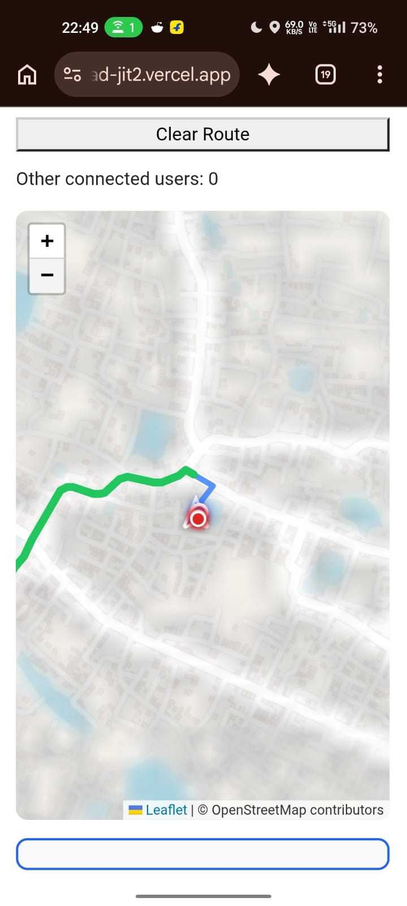
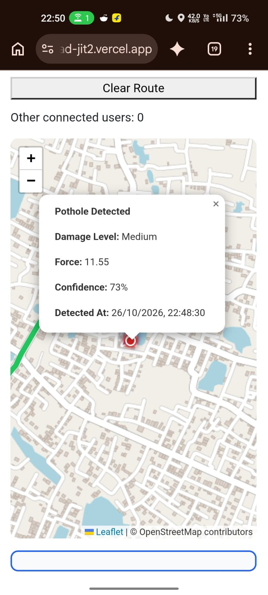

# Road Damage Detection & Smart Routing
## Technical Documentation — Sensor Monitoring, Damage Detection & Mobile Navigation

**Project Developer:** Shubhayu Barua  
**Academic Program:** B.Tech Computer Science & Engineering (AI & ML)  
**Project Type:** Road Monitoring and Smart Navigation System

---

# 16. Frontend Sensor Monitoring

## 16.1 Overview

The frontend sensor monitoring component collects GPS location and device motion information while the user is navigating.

It is implemented as a custom React hook named `useSensorApi`.

The hook connects the browser's device sensors with the backend sensor-processing API.

Its main responsibilities are:

- Requesting motion sensor permission.
- Tracking the device's geographic location.
- Collecting accelerometer readings.
- Combining GPS and motion data.
- Controlling the frequency of API requests.
- Sending sensor information to the backend.
- Receiving and storing damage detection results.

## 16.2 React Hooks Used

| React Hook | Purpose |
|---|---|
| `useState` | Stores damage information, errors and motion permission status |
| `useEffect` | Manages GPS and motion event listeners |
| `useRef` | Stores the latest sensor readings and request state |
| `useCallback` | Maintains reusable callback functions |

## 16.3 GPS Tracking

The application uses the browser Geolocation API:

```javascript
navigator.geolocation.watchPosition()
```

GPS tracking runs only when `isNavigating` is true.

The following information is collected:

| Property | Description |
|---|---|
| `latitude` | Current geographic latitude |
| `longitude` | Current geographic longitude |
| `speed` | Device-reported speed |

The latest location is stored in a reference:

```javascript
const latestLocation = useRef({
    lat: null,
    lng: null,
    speed: 0
});
```

The GPS configuration is:

```javascript
{
    enableHighAccuracy: true,
    maximumAge: 1000,
    timeout: 10000
}
```

When the GPS effect is cleaned up, `clearWatch()` stops the location watcher.

## 16.4 Motion Sensor Permission

The application requests access to device motion through:

```javascript
requestMotionPermission()
```

The hook checks whether `DeviceMotionEvent` is supported.

For browsers that require explicit permission, it calls:

```javascript
DeviceMotionEvent.requestPermission()
```

Motion tracking is enabled only after permission is granted.

This permission request should be initiated by a user interaction, such as pressing the Start Navigation button.

## 16.5 Accelerometer Data Collection

The application listens for the browser's `devicemotion` event.

```javascript
window.addEventListener(
    "devicemotion",
    handleMotion
);
```

The hook reads:

```javascript
event.accelerationIncludingGravity
```

The following acceleration components are collected:

| Property | Description |
|---|---|
| `ax` | X-axis acceleration |
| `ay` | Y-axis acceleration |
| `az` | Z-axis acceleration |

The latest readings are stored in:

```javascript
const latestSensorData = useRef({
    ax: 0,
    ay: 0,
    az: 0
});
```

The current implementation uses `accelerationIncludingGravity`, meaning the collected readings include the gravitational component. Gravity estimation and removal are performed by the backend processing engine.

## 16.6 Sensor API Communication

The frontend sends the collected information to:

```http
POST /api/sensor/sensor-data
```

The backend URL is configured using:

```javascript
process.env.REACT_APP_BACKEND_URL
```

### Example request payload

```json
{
    "lat": 22.6971753,
    "lng": 88.3805627,
    "speed": 0,
    "ax": 0,
    "ay": 0,
    "az": 0
}
```

The coordinates and sensor values above are illustrative.

### Request throttling

The hook uses:

```javascript
const THROTTLE_INTERVAL = 1000;
```

This limits request initiation to approximately one request per second under normal conditions.

It also maintains an in-flight request flag to prevent overlapping requests.

If a request is already being processed, another request is skipped rather than queued.

## 16.7 Backend Response Handling

After receiving the response, the frontend checks:

```javascript
data.success
data.data
```

If the response is valid, the hook extracts the damage information:

```javascript
setDamage({
    lat: result.lat,
    lng: result.lng,
    level: result.damageLevel
});
```

The returned damage state can be used by the frontend to display damage information geographically.

The hook also exposes sensor errors and motion permission status to its parent component.

## 16.8 Returned Hook Values

```javascript
{
    damage,
    requestMotionPermission,
    sensorError,
    motionEnabled
}
```

| Return Value | Description |
|---|---|
| `damage` | Latest damage result |
| `requestMotionPermission` | Requests device motion permission |
| `sensorError` | Stores sensor or API errors |
| `motionEnabled` | Indicates whether motion access was enabled |

---

# 17. Backend Sensor Processing Engine

## 17.1 Overview

The Backend Sensor Processing Engine analyzes raw accelerometer readings received from the frontend.

It processes incoming sensor values through several stages:

1. Gravity estimation and removal.
2. Linear acceleration calculation.
3. Acceleration magnitude calculation.
4. Vibration value extraction.
5. Moving average smoothing.
6. Fuzzy membership evaluation.
7. Final damage classification.

The engine is implemented in JavaScript using Node.js.

Pino is used for structured logging.

## 17.2 Technology and Configuration

| Component | Configuration |
|---|---|
| Runtime | Node.js |
| Logging | Pino |
| Gravity filtering | Exponential Moving Average |
| Smoothing | Moving Average |
| Buffer size | 5 readings |
| Gravity smoothing factor | 0.95 |
| Classification | Fuzzy Membership Functions |
| Decision strategy | Winner Takes All |

## 17.3 Sensor Processing Pipeline

```text
Raw Accelerometer Readings
          |
          v
Gravity Estimation
          |
          v
Gravity Removal
          |
          v
Linear Acceleration
          |
          v
Magnitude Calculation
          |
          v
Vibration Value
          |
          v
Moving Average Smoothing
          |
          v
Fuzzy Membership Evaluation
          |
          v
Winner Takes All
          |
          v
Damage Classification
          |
          v
Return Result
```

## 17.4 Structured Logging

The engine uses Pino for structured logging.

```javascript
const pino = require("pino");

const logger = pino({
    transport: {
        target: "pino-pretty",
    }
});
```

The logging component records:

- Raw accelerometer readings.
- Calculated linear acceleration.
- Acceleration magnitude.
- Smoothed vibration value.
- Final damage classification.
- Classification confidence.

These logs help monitor the sensor-processing pipeline and investigate unexpected results.

## 17.5 Gravity Removal

Raw accelerometer readings may contain both vehicle movement acceleration and gravitational acceleration.

The engine estimates the gravity component using an Exponential Moving Average (EMA).

The smoothing factor is:

```javascript
const alpha = 0.95;
```

The estimated gravity is updated independently for each axis.

\[
G_t = \alpha G_{t-1}+(1-\alpha)A_t
\]

Where:

- \(G_t\) = Current estimated gravity.
- \(G_{t-1}\) = Previous gravity estimate.
- \(A_t\) = Current raw acceleration.
- \(\alpha\) = Smoothing factor.

The linear acceleration is calculated by subtracting estimated gravity:

\[
L_t=A_t-G_t
\]

The same operation is applied to the X, Y and Z axes.

### Initialization

During the first sensor reading, the gravity estimate is initialized using the raw acceleration values.

The function returns zero linear acceleration for this first reading.

This prevents the initial gravitational component from being interpreted as vehicle vibration.

## 17.6 Acceleration Magnitude

After gravity removal, the engine calculates the magnitude of the linear acceleration vector.

\[
M=\sqrt{x^2+y^2+z^2}
\]

Where:

- \(x\) = Linear acceleration along the X-axis.
- \(y\) = Linear acceleration along the Y-axis.
- \(z\) = Linear acceleration along the Z-axis.

Implementation:

```javascript
function getMagnitude(x, y, z) {
    return Math.sqrt(x*x + y*y + z*z);
}
```

Magnitude combines the three acceleration components into a single value.

This allows the engine to analyze overall acceleration intensity instead of evaluating each axis independently.

## 17.7 Vibration Extraction

The current implementation uses the calculated acceleration magnitude directly as its vibration value.

```javascript
function getVibration(magnitude) {
    return magnitude;
}
```

Therefore, the vibration value is equivalent to the magnitude of the gravity-removed acceleration vector.

No additional frequency-domain analysis or vibration transformation is performed in this function.

## 17.8 Moving Average Smoothing

Sensor readings can fluctuate because of noise and irregular vehicle movement.

To reduce short-term fluctuations, the engine maintains a moving buffer.

```javascript
let buffer = [];
const MAX_SIZE = 5;
```

Each new vibration value is added to the buffer.

When the buffer exceeds five readings, the oldest reading is removed.

The smoothed value is calculated using:

\[
S_t=\frac{1}{N}\sum_{i=1}^{N}V_i
\]

Where:

- \(S_t\) = Smoothed vibration value.
- \(V_i\) = Individual vibration readings.
- \(N\) = Number of readings currently in the buffer.

Implementation:

```javascript
function smooth(vibrationValue) {
    buffer.push(vibrationValue);

    if (buffer.length > MAX_SIZE) {
        buffer.shift();
    }

    return buffer.reduce((a, b) => a + b, 0)
        / buffer.length;
}
```

The buffer initially contains fewer than five readings. Once five readings are collected, it maintains a rolling window of the latest five values.

## 17.9 Fuzzy Logic Classification

The engine uses fuzzy membership functions to evaluate the smoothed vibration value.

It calculates membership values for three categories:

- Low
- Medium
- High

Each membership value represents the degree to which the input vibration belongs to that category.

### Low Membership Function

| Input value | Membership |
|---|---|
| \(x \leq 5\) | 1 |
| \(5 < x < 12\) | Decreases linearly |
| \(x \geq 12\) | 0 |

\[
\mu_{Low}(x)=
\begin{cases}
1 & x\leq5\\
\frac{12-x}{7} & 5<x<12\\
0 & x\geq12
\end{cases}
\]

### Medium Membership Function

The Medium membership function increases from 5 to 14 and decreases from 14 to 22.

| Input value | Membership |
|---|---|
| \(x \leq 5\) | 0 |
| \(5 < x \leq 14\) | Increases linearly |
| \(14 < x < 22\) | Decreases linearly |
| \(x \geq 22\) | 0 |

\[
\mu_{Medium}(x)=
\begin{cases}
0 & x\leq5\\
\frac{x-5}{9} & 5<x\leq14\\
\frac{22-x}{8} & 14<x<22\\
0 & x\geq22
\end{cases}
\]

### High Membership Function

The High membership function increases between 18 and 25.

| Input value | Membership |
|---|---|
| \(x \leq 18\) | 0 |
| \(18 < x < 25\) | Increases linearly |
| \(x \geq 25\) | 1 |

\[
\mu_{High}(x)=
\begin{cases}
0 & x\leq18\\
\frac{x-18}{7} & 18<x<25\\
1 & x\geq25
\end{cases}
\]

## 17.10 Winner Takes All Decision

After calculating the three membership values, the engine compares them.

```javascript
let scores = [
    { label: "Low", value: lVal },
    { label: "Medium", value: mVal },
    { label: "High", value: hVal }
];
```

The category with the highest membership value becomes the final classification.

The reported confidence is calculated as:

\[
Confidence=\mu_{winner}\times100
\]

For example, if the highest membership value is 0.8, the returned membership score is 80%.

### Low Vibration Special Case

If the smoothed vibration value is below 1.5, the engine returns:

```javascript
{
    label: "NONE",
    confidence: "0%"
}
```

This bypasses the three fuzzy membership functions.

## 17.11 Main Sensor Analysis Function

The `analyzeSensor()` function coordinates the complete processing pipeline.

```javascript
function analyzeSensor(ax, ay, az) {
    const linear = removeGravity(ax, ay, az);

    const magnitude = getMagnitude(
        linear.x,
        linear.y,
        linear.z
    );

    const vibration = getVibration(magnitude);
    const smoothVibration = smooth(vibration);

    const finalDecision = getFinalDecision(
        smoothVibration
    );

    return {
        force: smoothVibration,
        damageLevel: finalDecision.label,
        confidence: finalDecision.confidence
    };
}
```

The function returns three important values:

| Field | Description |
|---|---|
| `force` | Smoothed vibration magnitude |
| `damageLevel` | Final classification |
| `confidence` | Winning fuzzy membership percentage |

The module exports the function:

```javascript
module.exports = { analyzeSensor };
```

This allows the backend sensor route to import and use the processing engine.

## 17.12 Processing Output

An illustrative output from the processing engine:

```json
{
    "force": 19.45,
    "damageLevel": "Medium",
    "confidence": "32%"
}
```

These values are illustrative and do not represent a measured road condition.

## 17.13 Important Implementation Considerations

1. **Gravity estimation:** The EMA uses a smoothing factor of 0.95. Its effectiveness depends on sensor orientation, sampling rate and vehicle movement.

2. **First reading:** The first reading initializes the gravity estimate and produces zero linear acceleration.

3. **Moving average:** The five-reading buffer reduces short-term fluctuations but can delay the response to sudden impacts.

4. **Fuzzy membership:** Membership values represent the degree of membership in a category. They are not automatically statistically calibrated probabilities.

5. **Winner Takes All:** The classification selects the category with the highest membership value. The returned confidence is the winning membership percentage, not a validated model accuracy or probability.

6. **Shared processing state:** Gravity and buffer variables are declared at module scope. They are shared across calls to `analyzeSensor()` within the same Node.js module instance. Independent sensor streams require separate processing states.

7. **Threshold validation:** The thresholds should be evaluated using real sensor data collected under different road and vehicle conditions.

8. **Physical interpretation:** The code does not explicitly convert acceleration values into a documented physical unit. Thresholds must be interpreted using the actual units and scale supplied by the device sensors.

---

# 18. Mobile Interface and Live Demonstration

## 18.1 Overview

The project provides a mobile-accessible web interface for road monitoring and route visualization.

The interface uses Leaflet to display geographic information, route geometry, user location and road damage locations.

The mobile demonstration showcases how route planning, navigation and pothole detection information are presented together.

## 18.2 Live Map Interface

The mobile map interface demonstrates:

- Interactive Leaflet map.
- Map zoom controls.
- Route visualization.
- Current location marker.
- Damage location marker.
- Clear Route control.
- Connected-user count.

The map uses OpenStreetMap map data with Leaflet for rendering.

### Screenshot: Mobile Live Map



*The screenshot shows a mobile map with a displayed route and a location marker.*

## 18.3 Route Planning Demonstration

The recorded demonstration shows the route-planning workflow.

The user can:

1. Enter a starting location.
2. Enter a destination.
3. Select a travel mode.
4. Request route calculation.
5. View the calculated route on the map.

The recorded example displays:

| Route Information | Demonstration Value |
|---|---|
| Distance | 3.72 km |
| Estimated duration | 5 minutes |

These values represent one recorded demonstration, not fixed system performance.

## 18.4 Live Navigation

The interface provides a Start Live Navigation control.

The recorded workflow demonstrates navigation activation and a Live Navigation Active status.

The frontend sensor-monitoring hook is designed to collect GPS and motion information during active navigation, subject to browser support and permissions.

## 18.5 Pothole Detection Popup

The application displays detected damage locations geographically.

When the user selects a damage marker, a popup provides additional information.

### Screenshot: Pothole Detection Result



The recorded popup contains the following values:

| Field | Recorded Value |
|---|---|
| Detection status | Pothole Detected |
| Damage Level | Medium |
| Force | 11.55 |
| Confidence | 73% |
| Detected At | 26/10/2026, 22:48:30 |

These values are taken from the recorded mobile demonstration.

### Relationship Between Force and Confidence

The recorded force value is 11.55.

For the Medium membership function:

\[
\mu_{Medium}(11.55)=\frac{11.55-5}{9}
\]

\[
\mu_{Medium}(11.55)\approx0.7278
\]

Converting this membership value into a percentage:

\[
0.7278\times100\approx72.78\%
\]

After rounding, the result is 73%.

Therefore, the displayed Medium classification and 73% membership score are consistent with the implemented fuzzy membership function, assuming the popup uses the same smoothed value.

**Important:** This is a fuzzy membership score, not a statistically validated probability that a pothole is present.

## 18.6 Connected Users

The interface displays the number of other connected users.

The recorded screenshots show:

```text
Other connected users: 0
```

This is the connected-user count at the time of recording. It does not indicate the maximum supported number of users.

## 18.7 Complete Mobile Demonstration

The recorded mobile video demonstrates the application workflow, including route planning, route display, navigation activation and map interaction.

**Demo video:**

[Watch the Mobile Road Damage Demonstration](Road-Damage1.mp4)

## 18.8 Demonstration Summary

The recorded demonstration provides visual evidence of:

1. Mobile map rendering.
2. Route visualization.
3. Route distance and estimated duration display.
4. Live navigation activation.
5. Geographic pothole visualization.
6. Damage classification popup.
7. Force and membership score display.
8. Connected-user count display.

---

# 19. End-to-End System Workflow

## 19.1 Frontend-to-Backend Sensor Flow

The sensor monitoring and processing components work together through the following workflow:

```text
User Starts Navigation
          |
          v
Motion Permission Request
          |
          v
GPS Tracking Starts
          |
          v
Accelerometer Readings Collected
          |
          v
Latest GPS + Sensor Data Combined
          |
          v
Request Throttling
          |
          v
POST /api/sensor/sensor-data
          |
          v
Backend Sensor Route
          |
          v
analyzeSensor(ax, ay, az)
          |
          v
Gravity Removal
          |
          v
Magnitude + Smoothing
          |
          v
Fuzzy Classification
          |
          v
Damage Result Returned
          |
          v
Frontend Damage State Updated
          |
          v
Map Damage Visualization
```

This diagram represents the intended integration between the supplied frontend hook and backend processing engine. The exact backend route implementation and map-marker update mechanism should be verified against their respective source files.

## 19.2 Separation of Responsibilities

| Component | Responsibility |
|---|---|
| Frontend GPS tracking | Collects geographic location |
| Frontend motion tracking | Collects device acceleration |
| Frontend API hook | Sends sensor data |
| Backend sensor route | Handles incoming sensor requests |
| Sensor processing engine | Analyzes acceleration values |
| Fuzzy classifier | Assigns a damage category |
| Map interface | Displays geographic information |

---

# 20. Testing and Validation

The following test cases can be used to evaluate the existing implementation.

| Test Case | Expected Behaviour |
|---|---|
| Motion sensor unavailable | Display an appropriate error |
| Motion permission denied | Motion monitoring remains disabled |
| GPS unavailable | Display a GPS error |
| GPS coordinates unavailable | Do not send sensor request |
| Backend returns HTTP error | Store API error |
| Backend returns invalid response | Display request failure |
| First sensor reading | Initialize gravity estimate |
| Vibration below 1.5 | Return NONE |
| Vibration in Low membership range | Evaluate Low membership |
| Vibration in Medium membership range | Evaluate Medium membership |
| Vibration in High membership range | Evaluate High membership |
| Multiple overlapping requests | Prevent another request from starting |

### Validation Requirements

Further evaluation should include:

- Sensor readings collected from different devices.
- Different vehicle speeds.
- Smooth roads and damaged roads.
- Different road surfaces.
- Different phone orientations.
- Repeated observations at the same road location.
- Comparison between predicted damage levels and manually verified road conditions.

These tests are proposed validation activities; they should not be represented as completed experiments until results are recorded.

---

# 21. Known Limitations

The current implementation has several limitations that should be considered.

## 21.1 Sensor Limitations

- Accelerometer readings may contain noise.
- Phone orientation affects the relationship between device axes and vehicle movement.
- Gravity estimation may be affected by rapid changes in orientation.
- The moving average can smooth out short-duration impacts.
- Sensor thresholds may behave differently across devices.

## 21.2 Processing Limitations

- The current vibration extraction function directly returns acceleration magnitude.
- No frequency-domain analysis is implemented.
- Fuzzy thresholds require experimental validation.
- Membership scores are not calibrated probabilities.
- Gravity and smoothing state are shared across calls within one module instance.

## 21.3 Geographic Limitations

- GPS readings may contain location errors.
- A detected vibration does not automatically establish the exact location or identity of a pothole.
- Repeated detections at nearby locations may require geographic clustering and duplicate handling.
- A damage location may need to be matched to the correct road segment.

## 21.4 Navigation Limitations

- A route displayed on the map does not automatically mean road-condition-aware route selection has been implemented.
- Traffic congestion and physical road damage are different types of information.
- Dynamic damage penalties require validation before being used in production route selection.

---

# 22. Future Improvements

Potential improvements include:

### Sensor Processing

- Per-device sensor-processing state.
- Improved gravity estimation.
- Sensor orientation handling.
- Adaptive filtering.
- Frequency-domain vibration analysis.
- Device-specific calibration.

### Damage Detection

- Improved damage severity estimation.
- Experimental threshold optimization.
- Confidence calibration.
- Historical damage analysis.
- Duplicate detection handling.

### Geographic Processing

- Improved GPS accuracy handling.
- Road-segment matching.
- Spatial indexing.
- Damage density visualization.
- Historical road-condition layers.

### Smart Routing

- Incorporation of road damage into route cost.
- Dynamic damage penalties.
- Alternative route comparison.
- Route quality evaluation.
- Trade-off analysis between distance, travel time and road condition.

### Platform Improvements

- Improved mobile user interface.
- Better error reporting.
- Real-time monitoring.
- Administrative dashboard.
- Road damage reporting and verification workflow.

---

# 23. Conclusion

Road Damage Detection & Smart Routing combines sensor-based road monitoring, backend signal processing, geographic visualization and route planning.

The frontend collects device location and motion information, while the backend processes accelerometer readings through gravity estimation, smoothing and fuzzy membership classification.

The resulting damage information can be associated with geographic coordinates and presented through an interactive mobile map.

The recorded mobile demonstration shows route visualization, navigation activation and a pothole detection popup containing damage level, force and confidence information.

The project provides a foundation for developing a more comprehensive road monitoring and road-condition-aware navigation system.

Further work is required to validate sensor thresholds, improve geographic accuracy, calibrate confidence estimates and evaluate the effectiveness of damage-aware routing.

---
